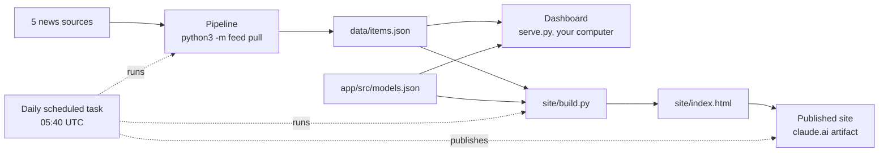

# How the pieces fit

[← Index](README.md)

The project has one data pipeline and two places that show its output.

## The parts

**The pipeline** (`feed/`). Fetches the five sources, merges new stories into one list, and prunes
old ones. Run it with `python3 -m feed pull`. Its output is `data/items.json`. It follows strict rules
(see `AGENTS.md` → Invariants): a broken source keeps its old stories instead of emptying the feed,
paid scrapes are never retried, a corrupt file is refused.

**The five sources** (defined in `feed/pull.py`):

| Source | How it is read | Cost |
| --- | --- | --- |
| Anthropic news | scraped with Firecrawl | 1 credit per pull, needs `FIRECRAWL_API_KEY` |
| Claude API release notes | RSS feed | free |
| Claude Code releases | GitHub Atom feed | free, needs `github.com` reachable |
| OpenAI news | RSS feed | free |
| Nous blog | scraped with Firecrawl | 1 credit per pull, needs `FIRECRAWL_API_KEY` |

**The dashboard** (`app/` + `serve.py`). The original product: a page that runs on your own
computer at <http://127.0.0.1:8787>. `serve.py` serves it and runs the pipeline itself every day at
06:00 UTC. Nothing leaves your machine.

**The model catalog** (`app/src/models.json`). Hand-written notes on current models: specs,
strengths, weaknesses. Used by both the dashboard and the site.

**The site** (`site/`). A single web page published on claude.ai with two tabs: the news feed and
the model catalog. See [The site](site.md).

**The daily refresh**. A Claude scheduled task that does, in the cloud, what `serve.py` does on your
computer: pull, build, publish. See [Daily refresh](daily-refresh.md).

## Dashboard vs site

| | Dashboard | Site |
| --- | --- | --- |
| Where it runs | your computer | claude.ai |
| Who can see it | only you, on that computer | you, plus anyone you share it with |
| Refresh | `serve.py`, 06:00 UTC | scheduled task, 05:40 UTC |
| Remembers between pulls | yes (`data/state.json`, tombstones) | no, each run starts fresh (see [Daily refresh](daily-refresh.md#limitations)) |
| Look | Mythological Punk theme (navy, brass) | calm dark theme, brand accents |

Related: [Glossary](glossary.md).
